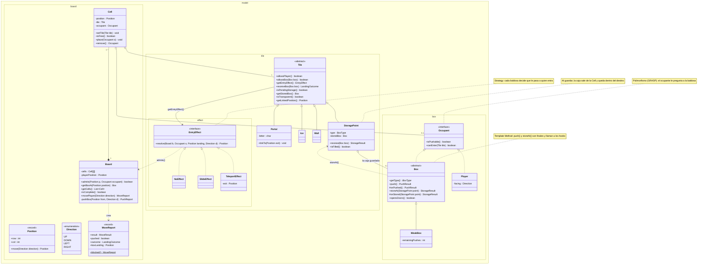

# Prompt para generar el Diagrama de Clases (Mermaid)

> **Este prompt describe el código tal como quedó**, no un diseño previsto.
> Se armó leyendo la API pública real de las 89 clases de `src/main/java`.
> Si el código cambia, hay que regenerarlo.
>
> Uso sugerido: pegarlo en cualquier LLM para que devuelva el código **Mermaid**.
> GitHub renderiza Mermaid de forma nativa, así que los bloques se pueden pegar tal
> cual en el README o en el informe y se ven como diagrama, sin subir imágenes.
>
> ⚠️ **Ojo con el entregable:** la consigna pide el diagrama **en StarUML**. Mermaid no
> se importa directo a StarUML. Sirve para versionar el diagrama junto al código y
> revisarlo rápido en el navegador, pero el archivo `.mdj` que se entrega hay que
> armarlo igual en StarUML, usando estos diagramas como guía.
>
> **Verificar siempre lo que salga contra el código.** La consigna exige poder defender
> cada decisión, y un diagrama que no coincide con el código es peor que no tenerlo.

---

## PROMPT

````
Generá un diagrama de clases UML en Mermaid para un juego Sokoban en Java 21 + Swing,
desarrollado como trabajo integrador de Proceso de Desarrollo de Software. El diagrama
va en español, agrupado por paquetes, y tiene que hacer explícitos los patrones de
diseño aplicados.

FORMATO DE SALIDA — Mermaid `classDiagram`

- Devolvé **código Mermaid**, no PlantUML. Cada diagrama en su propio bloque
  ```mermaid ... ``` para que GitHub lo renderice.
- Son **cuatro diagramas separados** (Mermaid no tiene `newpage`), cada uno en su
  propio bloque y con un título en Markdown arriba:
    1. Tablero y baldosas  — `model.board`, `model.tile`, `model.tile.effect`,
       `model.tile.mechanism`, `model.box`
    2. Ciclo de juego      — `model.game`, `.state`, `.event`, `.loss`, `.score`
    3. Historial y carga   — `model.history`, `factory`, `port`, `exception`
    4. Vista y servicios   — `view`, `controller`, `service`, `Main`
  Las clases que se repiten entre diagramas (por ejemplo `Level`, `Board` o `Game`)
  se vuelven a declarar vacías, solo como punto de anclaje de las flechas.
- Empezá cada bloque con `classDiagram` y `direction TB`.

REGLAS DE SINTAXIS MERMAID QUE HAY QUE RESPETAR

- ⛔ **Las relaciones van FUERA de los bloques `namespace`, nunca adentro.** Declarar
  una flecha dentro de un `namespace` es un error de parseo y el diagrama no se
  dibuja. Es el error más fácil de cometer. Primero todos los `namespace` con sus
  clases, y recién después todas las flechas y las notas.
- **Agrupar por paquete** con `namespace nombre.del.paquete { ... }`.
- **Genéricos con virgulilla**: `List~Cell~`, `Map~SpriteKey, BufferedImage~`,
  `IntFunction~Level~`, `Deque~LevelMemento~`. Es la notación propia de Mermaid;
  con `<` y `>` el texto queda a merced del renderizador de HTML.
- **Miembros**: `+metodo(Tipo param) TipoRetorno` y `-campo : Tipo`. El tipo de retorno
  va **al final y sin dos puntos**.
- **Estático**: sufijo `$` → `+of(Board board) LevelMemento$`
- **Abstracto**: sufijo `*` → `+getType() BoxType*`
- **Estereotipos**: dentro del cuerpo de la clase, en su propia línea:
  `class Occupant { <<interface>> ... }`. Para enums usar `<<enumeration>>`, para
  records `<<record>>` y para clases abstractas `<<abstract>>`.
  Los valores de un enum se listan como miembros sueltos, sin paréntesis.
- **Flechas** (iguales que en UML clásico):
  herencia `<|--`, realización `<|..`, composición `*--`, agregación `o--`,
  asociación `-->`, dependencia `..>`
- **Multiplicidades entre comillas** a los costados de la flecha:
  `Board "1" *-- "1..*" Cell`
- **Etiqueta de la relación** después de dos puntos: `Tile --> EntryEffect : getEntryEffect()`
- **Notas**: `note for NombreDeClase "texto"`, declaradas al final junto con las flechas.
- No usar comillas dobles dentro de los nombres de clase ni de los miembros.

CONTENIDO
- Mostrar los miembros públicos relevantes. Omitir getters y setters triviales; sí
  incluir los métodos que expresan comportamiento.
- Poner una `note for ...` en cada clase que encabeza un patrón, diciendo el patrón y
  el rol (por ejemplo: `note for EntryEffect "Strategy: cada baldosa decide que le pasa
  a quien entra"`).
- ⚠️ El inventario de clases que sigue está escrito en **notación Java**
  (`List<Cell>`, `Map<K, V>`, `{static}`, `{abstract}`, `<<final>>`, `metodo(): Tipo`).
  Hay que **traducirlo** a la sintaxis Mermaid descrita arriba: genéricos con `~`,
  tipo de retorno al final sin dos puntos, `$` para estático y `*` para abstracto.
  `<<final>>` no tiene equivalente en Mermaid: dejalo como nota si aporta.

================================================================ PAQUETES Y CLASES

com.sokoban
  + Main   -- punto de entrada; arma modelo, vista y controladores en el EDT

--------------------------------------------------------------- com.sokoban.model.board

<<record>> Position(row: int, col: int)
  + move(Direction): Position

<<enumeration>> Direction : UP, DOWN, LEFT, RIGHT
  - rowOffset: int ; - colOffset: int

<<enumeration>> MoveResult : OK, BLOCKED, BROKEN

<<record>> MoveReport(result: MoveResult, pushed: boolean, outcome: LandingOutcome,
                      boxLanding: Position)
  + {static} blocked(): MoveReport
  -- lo que pasó en un movimiento; evita que Level deduzca el empuje mirando el tablero

<<record>> PushReport(result: PushResult, outcome: LandingOutcome, landing: Position)
  -- package-private, uso interno de Board

Cell
  - position: Position ; - tile: Tile ; - occupant: Occupant
  + getTile(): Tile ; + setTile(Tile)        // la baldosa cambia al consumirse un cerrojo
  + getOccupant(): Occupant ; + isFree(): boolean
  + place(Occupant) ; + remove(): Occupant

Board
  - cells: Cell[][] ; - playerPosition: Position
  + cellAt(Position): Cell ; + isInside(Position): boolean ; + getTile(Position): Tile
  + admits(Position, Occupant): boolean      // existe, la baldosa lo admite y está libre
  + getBoxAt(Position): Box                  // ocupante o caja ya guardada en el destino
  + getCells(): List<Cell>
  + countStoredBoxes(): int
  + isComplete(): boolean                    // condición de victoria
  + movePlayer(Direction): MoveReport
  - pushBox(Position, Direction): PushReport
  - applyLanding(Cell, LandingOutcome)
  + setPlayerPosition(Position)              // solo para restaurar un memento

VisibilityMap
  - visible: Set<Position>
  + isVisible(Position): boolean
  + recalculate(Board)   -- BFS sobre baldosas transparentes; atraviesa portales por
                            Tile.getLinkedPosition(); marca también las paredes en
                            diagonal para que no queden huecos en las esquinas

--------------------------------------------------------------- com.sokoban.model.tile
                                                                 [PATRÓN STRATEGY]
abstract Tile
  + allowsPlayer(): boolean
  + allowsBox(Box): boolean
  + getEntryEffect(): EntryEffect            // Strategy: qué le pasa a quien entra
  + receiveBox(Box): LandingOutcome          // qué provoca una caja que cae acá
  + isPendingStorage(): boolean              // ¿destino esperando su caja?
  + getStoredBox(): Box ; + setStoredBox(Box)
  + isTransparent(): boolean                 // ¿deja ver lo de atrás? (niebla)
  + getLinkedPosition(): Position            // conexión a distancia (portales)

Floor   -- hereda todo el comportamiento por defecto
Wall    -- isTransparent=false, allowsPlayer=false, allowsBox=false
Empty   -- igual que Wall; es el terreno inaccesible '%' y el relleno de filas cortas
Ice     -- getEntryEffect() devuelve un SlideEffect compartido
Portal  -- letter: char ; linkTo(Position) ; getEntryEffect()=TeleportEffect ;
           getLinkedPosition()=salida
StoragePoint
  - type: BoxType ; - storedBox: Box
  + receive(Box): StorageResult              // le pregunta a la caja (Template Method)
  + isFilled(): boolean
  + allowsPlayer() = isFilled()              // vacío es un hueco; lleno es puente
  + allowsBox(Box) = !isFilled()
  + receiveBox(Box): LandingOutcome          // si entra, se queda la caja

<<enumeration>> StorageResult : STORED, WRONG_BOX, KEY_NOT_USED
<<enumeration>> LandingOutcome : NONE, STORED, WRONG_STORAGE, KEY_NOT_USED, DOOR_OPENED

--------------------------------------------------------- com.sokoban.model.tile.effect
                                                                 [PATRÓN STRATEGY]
<<interface>> EntryEffect
  + resolve(Board, Occupant, landing: Position, Direction): Position
    -- devuelve la posición final, o null si el movimiento debe bloquearse

NoEffect        -- devuelve landing; corta la recursión del deslizamiento
SlideEffect     -- hielo: delega en el efecto de la celda siguiente, no itera
TeleportEffect  -- exit: Position (la fija LevelBuilder); devuelve exit, o null si
                   la salida está ocupada

------------------------------------------------------ com.sokoban.model.tile.mechanism
                                                                 [PATRÓN OBSERVER]
Door extends Tile
  - group: char ; - open: boolean
  + isOpen() ; + open() ; + close()
  + isTransparent() = open ; + allowsPlayer() = open ; + allowsBox(Box) = open

KeyTile extends Tile    -- SUBJECT
  - group: char ; - listeners: List<KeyTileListener>
  + addListener(KeyTileListener)
  + receiveBox(Box): LandingOutcome   -- si box.opensDoors(): marca la caja, notifica
                                         a los oyentes y devuelve DOOR_OPENED

<<interface>> KeyTileListener
  + onKeyTileActivated(group: char)

DoorGroup implements KeyTileListener   -- OBSERVER
  - group: char ; - doors: List<Door>
  + add(Door) ; + open() ; + close() ; + isOpen(): boolean

--------------------------------------------------------------- com.sokoban.model.box
                                             [TEMPLATE METHOD + POLIMORFISMO (GRASP)]
<<interface>> Occupant
  + isPushable(): boolean
  + canEnter(Tile): boolean   -- POLIMORFISMO (GRASP): cada ocupante le pregunta a la
                                 baldosa lo que le corresponde, así Board nunca
                                 pregunta "¿sos caja o jugador?"

Player implements Occupant
  - facing: Direction
  + getFacing() ; + face(Direction)
  + isPushable() = false ; + canEnter(t) = t.allowsPlayer()

abstract Box implements Occupant
  + {abstract} getType(): BoxType
  + canEnter(t) = t.allowsBox(this)
  + push(): PushResult                 <<final>>  -- esqueleto, llama al hook onPushed()
  # onPushed(): PushResult                        -- HOOK
  + storeAt(StoragePoint): StorageResult <<final>> -- valida el tipo y llama a onStored()
  # onStored(StoragePoint): StorageResult          -- HOOK
  + opensDoors(): boolean              -- hooks vacíos en la base para que el historial
  + markDoorOpened() ; + hasOpenedDoor()  y el casillero cerrojo nunca casteen
  + setDoorOpened(boolean)
  + getRemainingPushes(): int ; + setRemainingPushes(int)

NormalBox  -- no redefine ningún hook
WeakBox    -- remainingPushes: int ; redefine onPushed(): devuelve BROKEN al agotarse
KeyBox     -- doorOpened: boolean ; opensDoors()=true ;
              redefine onStored(): solo se guarda si ya abrió su muro

<<enumeration>> BoxType : NORMAL, WEAK, KEY
<<enumeration>> PushResult : PUSHED, BLOCKED, BROKEN

--------------------------------------------------------------- com.sokoban.model.game

Game   -- FACHADA del modelo y CONTEXT del patrón State
  - levelFactory: IntFunction<Level> ; - levelCount: int
  - state: GameState ; - currentLevel: Level ; - currentLevelNumber: int
  - levelListeners: List<GameListener>
  + start() ; + move(Direction) ; + undo() ; + restart() ; + nextLevel()
  + isInputBlocked(): boolean ; + getState(): GameState
  + addLevelListener(GameListener)  -- se reenganchan a cada Level nuevo
  + applyMove(Direction) ; + applyUndo(): boolean ; + hasNextLevel(): boolean
  + loadLevel(int)                  -- API que usan los estados
  NOTA: Game no tiene un solo `if` sobre el estado; delega y reemplaza el estado
        por el que le devuelven.

Level   -- ORIGINATOR del Memento
  - name, timeLimitSeconds, targetScore
  - board: Board ; - stats: LevelStats ; - history: UndoHistory
  - visibilityMap: VisibilityMap ; - listeners: List<GameListener>
  - {static} LOSS_CONDITIONS: List<LossCondition>   -- Strategy, evaluadas en orden
  - lossReason, lastOutcome, lastPushedBoxPosition, brokenBox, elapsedSeconds, openedDoors
  + move(Direction): MoveResult
  + undo(): boolean ; + getRemainingUndos(): int
  + isWon(): boolean ; + getLossReason(): LossReason
  + elapseSeconds(int) ; + getRemainingSeconds(): int
  + addListener(GameListener)
  + hasBrokenBox() ; + getLastOutcome() ; + getLastPushedBoxPosition()  -- para las
                                                                          LossCondition
  - evaluateLoss()      -- la victoria se chequea ANTES que la derrota
  - publish(...)        -- SUBJECT del Observer

LevelStats : moves, pushes, undos (+addMove, +addPush, +addUndo)

------------------------------------------------------ com.sokoban.model.game.state
                                                                 [PATRÓN STATE]
<<interface>> GameState
  + acceptsInput(): boolean
  + onMove(Game, Direction): GameState      <<default: return this>>
  + onUndo(Game): GameState                 <<default: return this>>
  + onNextLevel(Game): GameState            <<default: return this>>

MenuState           -- acceptsInput=false
PlayingState        -- acceptsInput=true; onMove decide Won / Blocked / Lost; onUndo
BlockedState        -- deadlock; onUndo vuelve a PlayingState
LostState           -- onUndo vuelve a PlayingState
WonState            -- onUndo no hace nada; onNextLevel carga el siguiente o completa
GameCompletedState  -- terminal

------------------------------------------------------ com.sokoban.model.game.event
                                                                 [PATRÓN OBSERVER]
<<interface>> GameListener
  + onEvent(GameEvent)

GameEvent : type: EventType, position: Position, direction: Direction
<<enumeration>> EventType : PLAYER_MOVED, BOX_PUSHED, DOOR_OPENED, UNDO,
                            LEVEL_WON, LEVEL_LOST

------------------------------------------------------- com.sokoban.model.game.loss
                                                                 [PATRÓN STRATEGY]
<<interface>> LossCondition
  + isMet(Level): boolean ; + getReason(): LossReason

BrokenBoxCondition        -- level.hasBrokenBox()
WrongStorageCondition     -- lastOutcome == WRONG_STORAGE
EarlyKeyStorageCondition  -- lastOutcome == KEY_NOT_USED
TimeOutCondition          -- remainingSeconds <= 0
DeadlockCondition         -- SOLO la caja recién empujada: esquina de paredes en los
                             dos ejes, o bloque 2x2 lleno de paredes y cajas

<<enumeration>> LossReason : DEADLOCK, TIME_OUT, BROKEN_BOX, WRONG_STORAGE,
                             EARLY_KEY_STORAGE

------------------------------------------------------ com.sokoban.model.game.score
                                                                 [PATRÓN STRATEGY]
<<interface>> ScoreCalculator
  + calculate(LevelStats, remainingSeconds: int, storedBoxes: int, openedDoors: int,
              targetScore: int): ScoreResult

StandardScoreCalculator  -- +1/segundo, +100/caja, +100/muro, -1/empuje, -250/undo;
                            estrellas: <=50% una, <=85% dos, resto tres
ScoreResult : score: int, stars: int

--------------------------------------------------------- com.sokoban.model.history
                                                          [COMMAND + MEMENTO]
<<interface>> Command
  + execute()
MoveCommand implements Command : game, direction  -- lo arma el InputController

<<final>> LevelMemento   -- MEMENTO
  - playerPosition, playerFacing
  - cells: List<CellSnapshot> ; - doors: List<DoorSnapshot>
  - storages: List<StorageSnapshot> ; - boxes: List<BoxSnapshot>
  + {static} of(Board): LevelMemento
  + restoreInto(Board)
  (CellSnapshot, DoorSnapshot y StorageSnapshot son records privados anidados;
   mostralos como clases internas o directamente omitilos)

<<record>> BoxSnapshot(box: Box, remainingPushes: int, doorOpened: boolean)
  + {static} of(Box): BoxSnapshot ; + restore()

UndoHistory   -- CARETAKER
  + {static} STEPS_PER_UNDO = 5 ; MAX_CONSECUTIVE_UNDOS = 3 ; CAPACITY = 15
  - mementos: Deque<LevelMemento> ; - remainingUndos: int
  + record(LevelMemento) ; + canUndo(): boolean ; + undo(): LevelMemento ; + clear()

NOTA IMPORTANTE para el diagrama: los contadores de LevelStats NO se guardan en el
memento a propósito, y el undo NO se resuelve invirtiendo comandos sino restaurando
una foto. Ponelo como nota al lado de LevelMemento.

--------------------------------------------------------------- com.sokoban.factory
                                                    [FACTORY METHOD + BUILDER]
<<interface>> CellCreator   -- FACTORY METHOD
  + create(Position, symbol: char): CellContent
WallCreator, DoorCreator, KeyTileCreator, PortalCreator, WeakBoxCreator
<<record>> CellContent(tile: Tile, occupant: Occupant)

LevelBuilder   -- BUILDER
  - contents: Map<Position, CellContent> ; - rows, cols, mapStartLine
  + withHeader(...) ; + withMapStartLine(int) ; + addCell(Position, CellContent)
  + build(): Level throws InvalidLevelException
  - linkPortals() ; - wireDoorGroups()
  - validate(): un solo Sokoban, cajas vs destinos por tipo, cerrojo<->muro,
    portales pareados, borde cerrado

LevelLoader   -- DIRECTOR del Builder
  - creators: Map<Character, CellCreator>
  + load(String): Level ; + parse(String): Level

--------------------------------------------------------------- com.sokoban.port
                                                                 [PUERTOS — DIP]
<<interface>> ProgressRepository : + save(Progress) ; + load(): Progress
Progress : lastUnlockedLevel: int

--------------------------------------------------------------- com.sokoban.service
                                                                 [ADAPTADORES]
FileProgressRepository implements ProgressRepository  -- archivo de texto
SoundService implements GameListener  -- clips: Map<SoundEffect, Clip>
                                         (javax.sound.sampled); +play(SoundEffect)
<<enumeration>> SoundEffect : MOVE, PUSH, STORE, BREAK, DOOR_OPEN, TELEPORT, UNDO,
                              WIN, LOSE
ProgressSaver implements GameListener -- persiste el progreso al recibir LEVEL_WON

--------------------------------------------------------------- com.sokoban.view
                                                                 [VISTA — Swing]
GameWindow extends JFrame   -- fachada de la vista, CardLayout
  - cards: CardLayout ; - root: JPanel ; - currentScreen: Screen
  - menuView, summaryView, boardView, hudView
  - scoreCalculator: ScoreCalculator
  + show(Screen) ; + showLevel() ; + refresh() ; + showGameCompleted()

<<enumeration>> Screen : MENU, GAME, SUMMARY
MenuView extends JPanel      -- botones Jugar / Continuar / Salir
SummaryView extends JPanel   -- movimientos, empujes, undos, tiempo, puntaje, estrellas
BoardView extends JPanel implements GameListener
  + fitToLevel() ; # paintComponent(Graphics)
  -- dibuja baldosa, caja guardada, ocupante y niebla; el mapeo baldosa->sprite vive
     acá, no en Tile
HudView extends JPanel implements GameListener
  -- nivel, movimientos, empujes, tiempo, undos + botones Deshacer y Reiniciar
SpriteCatalog   -- PURE FABRICATION (GRASP): cache Map<SpriteKey, BufferedImage>; SIZE = 48
<<record>> SpriteKey(name: String, facing: Direction) : + fileName(): String

--------------------------------------------------------------- com.sokoban.controller
InputController  -- Controller (GRASP). InputMap/ActionMap, no KeyListener.
                    +install(JComponent) ; +bind(JComponent, String, Command)
HudController    -- ActionListener de los botones -> game.undo() / game.restart()
GameClock        -- javax.swing.Timer de 1 s -> level.elapseSeconds(1)

--------------------------------------------------------------- com.sokoban.exception
InvalidLevelException extends Exception : line: int

========================================================= RELACIONES QUE DEBEN APARECER

Game *-- "1" Level              Game o-- "1" GameState        Game o-- "0..*" GameListener
Game --> IntFunction~Level~
Level *-- Board                 Level *-- LevelStats          Level *-- UndoHistory
Level *-- VisibilityMap         Level o-- "5" LossCondition   Level o-- "0..*" GameListener
Level ..> LevelMemento (crea)
UndoHistory *-- "0..15" LevelMemento
LevelMemento *-- "0..*" BoxSnapshot
Board "1" *-- "1..*" Cell
Cell o-- "1" Tile               Cell o-- "0..1" Occupant
Board ..> MoveReport            Board ..> PushReport
Tile <|-- Floor, Wall, Empty, Ice, Portal, StoragePoint, Door, KeyTile
Tile --> EntryEffect
EntryEffect <|.. NoEffect, SlideEffect, TeleportEffect
EntryEffect ..> Board (consulta admits)
KeyTile o-- "0..*" KeyTileListener
KeyTileListener <|.. DoorGroup
DoorGroup o-- "1..*" Door
Occupant <|.. Player            Occupant <|.. Box
Box <|-- NormalBox, WeakBox, KeyBox
StoragePoint o-- "0..1" Box (la caja guardada)
StoragePoint ..> Box (receive)  Box ..> StoragePoint (storeAt)
GameState <|.. MenuState, PlayingState, WonState, LostState, BlockedState,
               GameCompletedState
GameState ..> Game
GameListener <|.. BoardView, HudView, SoundService, ProgressSaver
CellCreator <|.. WallCreator, DoorCreator, KeyTileCreator, PortalCreator, WeakBoxCreator
LevelLoader o-- "1..*" CellCreator
LevelLoader ..> LevelBuilder    LevelBuilder ..> Level (crea)
LevelBuilder ..> DoorGroup (crea y suscribe)   LevelBuilder ..> Portal (aparea)
ProgressRepository <|.. FileProgressRepository
ProgressSaver --> ProgressRepository           ProgressSaver --> Game
Command <|.. MoveCommand        MoveCommand --> Game
GameWindow *-- MenuView, BoardView, HudView, SummaryView
BoardView --> SpriteCatalog     SpriteCatalog o-- "0..*" SpriteKey
InputController --> Game        InputController ..> Command
HudController --> Game          GameClock --> Game
Main ..> Game, GameWindow, LevelLoader, SoundService, ProgressSaver, los 3 controladores

=========================================== RESTRICCIÓN ARQUITECTÓNICA A REFLEJAR

Ninguna clase de com.sokoban.model, .factory, .port ni .exception tiene una flecha
hacia com.sokoban.view ni hacia javax.swing. La vista se entera de los cambios del
modelo SOLO a través de GameListener, y los controladores empujan acciones hacia Game.
Agregá una nota en el diagrama que lo diga explícitamente, como evidencia de MVC y del
principio de inversión de dependencias.

Mostrá también, como nota sobre StoragePoint, que una caja guardada deja de ser
ocupante de la Cell y pasa a estar dentro del StoragePoint: eso es lo que permite que
el jugador camine por encima de ella y que isComplete() sea polimórfico.
````

---

## Ejemplo validado de salida

Este es el **diagrama 1** (tablero y baldosas) escrito a mano siguiendo las reglas de
arriba. **Parsea sin errores con Mermaid 12.3.0**, así que sirve de referencia de la
forma que tiene que tener la salida y de banco de pruebas si algo no renderiza.

Está recortado a propósito (no están todas las baldosas ni todas las cajas): es un
ejemplo de formato, no el diagrama completo.



### Cómo validar el Mermaid que genere el modelo

GitHub renderiza estos bloques solo. Si uno no aparece, es un error de sintaxis, y lo
más rápido es pegarlo en <https://mermaid.live> para que marque la línea.

Lo que se verificó contra el parser de Mermaid 12.3.0 al armar estas reglas:

| Construcción | Resultado |
|---|---|
| `namespace` con clases adentro | ✅ válido |
| **Una flecha declarada dentro de un `namespace`** | ⛔ **error de parseo** |
| Genéricos `List~Cell~` | ✅ válido |
| `$` para estático, `*` para abstracto | ✅ válido |
| `<<record>>`, `<<enumeration>>`, `<<abstract>>`, `<<interface>>` | ✅ válido |
| Multiplicidades `"1" *-- "1..*"` | ✅ válido |
| Etiqueta de relación con `: texto` | ✅ válido |
| `note for Clase "texto"` | ✅ válido |

---

## Qué cambió respecto del prompt original

El prompt de la sección 7 de `PLAN-TP.md` describía el diseño **previsto**. Estas son
las diferencias con el código que efectivamente quedó:

| Qué | Antes (previsto) | Ahora (real) |
|---|---|---|
| `MoveReport`, `PushReport`, `LandingOutcome` | no existían | `Board` informa qué pasó en cada movimiento |
| `Occupant.canEnter(Tile)` | no estaba | polimorfismo (GRASP), para que `Board` no pregunte por el tipo |
| `EntryEffect.resolve(...)` | `(Board, Position, Direction)` | lleva también el `Occupant` |
| `Tile` | `allowsPlayer`, `allowsBox` | suma `receiveBox`, `isPendingStorage`, `getStoredBox`, `setStoredBox`, `isTransparent`, `getLinkedPosition` |
| `StoragePoint` | guardaba contra `allowsPlayer(Cell)` | **se queda con la caja**; no hizo falta cambiar ninguna firma |
| `Box` | se casteaba a `KeyBox` / `WeakBox` | hooks vacíos en la base: `opensDoors`, `markDoorOpened`, `get/setRemainingPushes`, `get/setDoorOpened` |
| `port.LevelSource` | estaba previsto | **no se implementó** (M15 sigue pendiente): `Game` usa `IntFunction<Level>` |
| `GameState` | tres métodos obligatorios | tres métodos con **default** `return this` |
| `Game` | — | suma `addLevelListener`, `applyMove`, `applyUndo`, `hasNextLevel`, `loadLevel` |
| `BoxSnapshot` | `(position, type, remainingPushes, doorOpened)` | `(box, remainingPushes, doorOpened)`; la posición la restaura el `CellSnapshot` |
| `LevelMemento` | solo cajas y puertas | cuatro listas: celdas, muros, destinos y cajas |
| `EventType` | 5 valores | 6: se agregó `UNDO` |
| `VisibilityMap` | iba a ser `GameListener` | la recalcula `Level`: el evento no lleva el `Board` |
| `model.tile.Void` | — | renombrado a `Empty` |
| `Screen`, `SpriteKey` | clases | `enum` y `record` |
